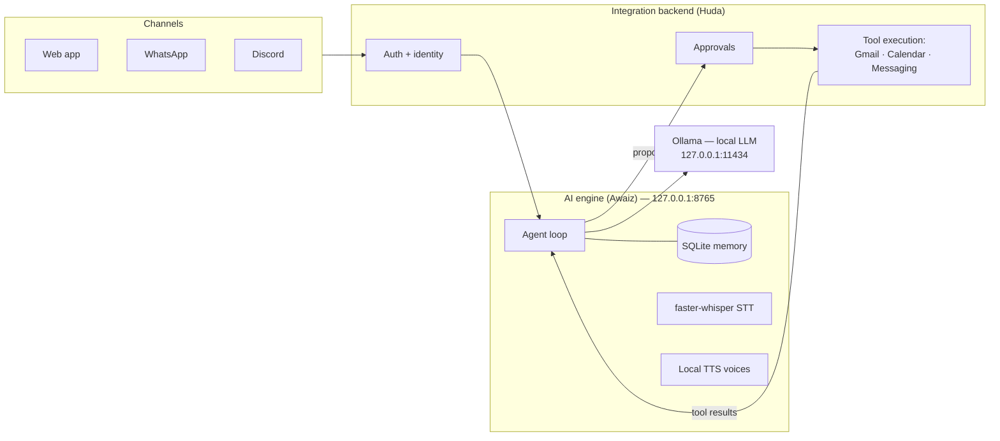

# Rabt

**Rabt** is a local-first personal AI communication assistant. You can say or type:

> "Hey Rabt, ask Huda when she's free tomorrow evening, find a suitable time for tuition, and prepare the appointment."

Rabt then:
1. Understands the request with a **local** LLM.
2. Checks **authorized free/busy** availability.
3. Recommends a time.
4. Prepares the booking.
5. Acts **only after you approve**.

It can reply by text or with a locally generated voice.

## Architecture



- **The AI proposes and the backend executes.** The engine returns schema-validated action proposals. The backend authorizes them, asks the user to approve side effects, executes, and reports back.
- **Runtime inference is 100% local.** Ollama, faster-whisper and local TTS run on this machine. No cloud LLM APIs are called at runtime.
- **Identity comes from the authenticated backend**, never from what a message claims.
- The contract between the two halves is **[docs/API_CONTRACT.md](docs/API_CONTRACT.md)**, backed by strict Pydantic models in [`shared/`](shared/).

## Repository layout and ownership

| Path | Owner | Contents |
|---|---|---|
| `shared/` | Awaiz | API contract: Pydantic models, tool catalog, JSON Schemas, example fixtures |
| `docs/API_CONTRACT.md` | Awaiz | Human-readable contract (read this first) |
| `ai-engine/` | Awaiz | FastAPI AI service: agent, Ollama client, STT, TTS, memory (branch `feat/awaiz-ai-core`) |
| `tests/ai/` | Awaiz | Contract + AI engine tests |
| Integration backend + frontend directories | Huda | WhatsApp, Gmail, Google Calendar, scheduling, approvals, UI. Huda chooses the names, e.g. `backend/` and `frontend/`. |

Don't edit the other owner's directories without discussing it first. Contract changes follow the process in [CLAUDE.md](CLAUDE.md#contract-change-process).

## Getting started

Prerequisites: Git, Python 3.11+ (3.12 recommended), [uv](https://docs.astral.sh/uv/).
The AI engine also needs [Ollama](https://ollama.com) and, optionally, an NVIDIA GPU.

```bash
git clone https://github.com/4waiz/rabt.git
cd rabt
uv sync          # creates the virtualenv and installs the workspace
uv run pytest    # contract tests
```

> **Windows + OneDrive:** if your clone lives in a OneDrive-synced folder, keep the virtualenv and runtime data out of it. Otherwise private conversations and GBs of CUDA libraries get uploaded:
> ```powershell
> $env:UV_PROJECT_ENVIRONMENT = "$env:LOCALAPPDATA\Rabt\venv"
> uv sync
> ```

Configuration: copy `.env.example` to `.env` and fill in the values. **Never commit `.env`**, OAuth client files, tokens, databases or voice samples. `.gitignore` already blocks the common ones.

## For Huda — start here

```bash
git clone https://github.com/4waiz/rabt.git
cd rabt
git checkout -b feat/huda-integrations
```

1. Read [docs/API_CONTRACT.md](docs/API_CONTRACT.md). It defines the six endpoints, five tools and the approval lifecycle.
2. Build against the example payloads in [`shared/fixtures/`](shared/fixtures/). They cover the full tuition-booking flow: proposal → free/busy result → recommendation → approval → booked, plus the rejected and failed paths.
3. For TypeScript, generate types from [`shared/jsonschema/`](shared/jsonschema/). For Python, `pip install -e shared` and import `rabt_shared`.
4. Until the AI engine lands on `main`, mock it with the fixtures. A mock client and a handoff guide (`docs/AI_HANDOFF.md`) come with the AI branch.

## Git workflow

- `main` only receives pull requests. Work on feature branches: `feat/awaiz-ai-core` and `feat/huda-*`.
- Never force-push or rewrite shared history.
- Keep commits small and scoped, e.g. `contract: …`, `ai: …`, `backend: …`.

## Security principles

- No arbitrary code execution from model output. There is a strict tool allowlist with strict argument schemas.
- Side-effect tools (`gmail.create_draft`, `calendar.create_event`, `messaging.send_message`) always require human approval. The schema enforces this.
- Emails, messages and tool outputs are untrusted data, never instructions.
- Cross-user calendar access is limited to free/busy windows.
- The AI engine and Ollama listen on loopback only and must never be exposed publicly.
