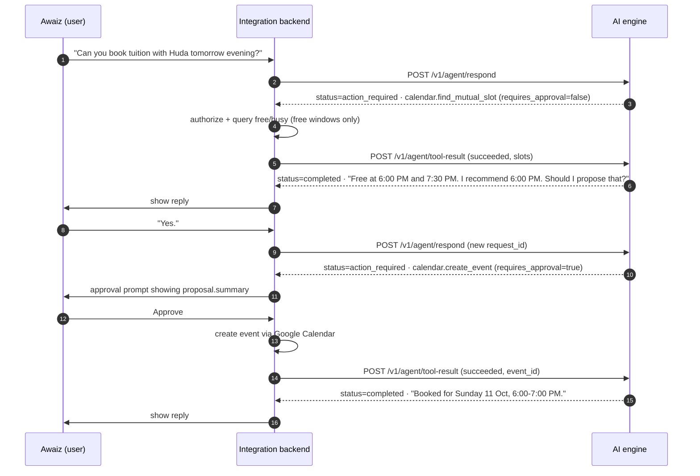

# Rabt API Contract — AI engine ⇄ integration backend

**Contract version: 0.1.0** · Source of truth: Pydantic models in [`shared/rabt_shared/`](../shared/rabt_shared/) ·
JSON Schemas: [`shared/jsonschema/`](../shared/jsonschema/) · Example payloads: [`shared/fixtures/`](../shared/fixtures/)

| Side | Owner | Responsibilities |
|---|---|---|
| **AI engine** (`ai-engine/`) | Awaiz | Local LLM (Ollama), agent reasoning, speech-to-text, text-to-speech, conversation memory. Returns **proposals** only. |
| **Integration backend** | Huda | User authentication, WhatsApp/Discord/web delivery, Gmail, Google Calendar, authorization, **approval UI**, tool execution. |

---

## 1. Trust model

```
 User (web / WhatsApp / Discord)
        │  authenticated by the backend
        ▼
 Integration backend ──── Authorization: Bearer <RABT_INTERNAL_API_KEY> ───▶ AI engine (127.0.0.1:8765)
  - owns Google / WhatsApp / Discord credentials                              - Ollama on 127.0.0.1:11434
  - authorizes + asks for approval + executes tools  ◀── proposals ─────────  - never executes external actions
  - reports outcomes                                 ─── tool results ─────▶  - SQLite memory, local STT/TTS
```

1. **Identity.** `account_id` is asserted by the backend after it has authenticated the user (web session, verified WhatsApp number, Discord user id). The engine never infers identity from message text. A message saying "I am Awaiz" proves nothing.
2. The engine rejects unregistered `account_id`s (`403 unknown_account`) and a `role` that differs from the registered role (`403 role_mismatch`).
3. **Execution.** The engine only proposes actions. The backend decides whether the user may perform them, asks for approval when `requires_approval` is `true`, executes them, and reports the outcome. No endpoint or tool lets the model approve its own proposal.
4. **Network exposure.** The engine binds to `127.0.0.1` by default and must never be exposed to the internet. The same applies to Ollama. Runtime inference is local only. The engine refuses hosted LLM endpoints.
5. **Untrusted content.** Emails, chat messages and tool outputs are data, never instructions. The engine treats them that way, and the backend must not forward third-party text as if the user had typed it.

### Registered accounts (v0.1)

| `account_id` | `role` | Default voice profile |
|---|---|---|
| `awaiz` | `tutor` | `awaiz-default` |
| `huda` | `student` | `huda-default` |

---

## 2. Conventions

| Topic | Rule |
|---|---|
| Base URL | `http://127.0.0.1:8765` (`RABT_HOST`, `RABT_PORT`) |
| Auth | Every endpoint except `GET /health` requires `Authorization: Bearer <RABT_INTERNAL_API_KEY>`. A missing or wrong key returns `401 unauthorized`. The key is a shared secret in both services' `.env` files and is never committed. |
| Body | UTF-8 JSON. **Unknown fields are rejected** (`422`). |
| IDs | UUID strings (v4 or v7). |
| Timestamps | ISO 8601 **with UTC offset**, e.g. `2026-10-11T18:00:00+04:00`. Naive timestamps are rejected. |
| Timezone | IANA name. Default `Asia/Dubai`. |
| Limits | JSON body ≤ 64 KiB · `message` ≤ 4096 chars · speech text ≤ 2000 chars · audio upload ≤ 25 MiB and ≤ 300 s |
| Headers on every response | `X-Request-Id` (echoes the body's `request_id` when present) and `X-Rabt-Contract-Version` |
| Errors | Always the envelope in [§9](#9-errors). |

---

## 3. Endpoints

| Method | Path | Auth | Purpose |
|---|---|---|---|
| `GET` | `/health` | — | Liveness only |
| `GET` | `/v1/agent/status` | Bearer | Model, GPU, STT and TTS readiness |
| `POST` | `/v1/agent/respond` | Bearer | Send a user message. Returns a reply and any proposals. |
| `POST` | `/v1/agent/tool-result` | Bearer | Report the outcome of one proposal. Returns the next reply. |
| `POST` | `/v1/audio/transcribe` | Bearer | Speech → text (multipart upload) |
| `POST` | `/v1/audio/speak` | Bearer | Text → speech (returns audio bytes) |

Interactive OpenAPI docs: `http://127.0.0.1:8765/docs` while the engine runs. A snapshot is published as `docs/openapi.json`.

---

## 4. Agent turn lifecycle



### Rules

1. **One user message = one turn = one fresh `request_id`.** Every tool result for proposals produced during that turn carries **the same `request_id`**.
2. Handle the response by `status`:
   - `completed`: show `reply_text`. Nothing to execute.
   - `action_required`: `reply_text` is an interim message (e.g. "Let me check…") and may be shown. Handle **every** entry in `action_proposals`.
   - `awaiting_results`: you reported one result, but other proposals from the same turn are still in `pending_proposal_ids`. `reply_text` may be empty; don't show it.
3. Handle each proposal as follows:
   - `requires_approval: false` (read-only): execute it if your authorization allows, then report the result.
   - `requires_approval: true`: show `summary` to the **requesting user** and ask for explicit approval. If approved, execute and report `succeeded` or `failed`. If declined, report `rejected`. **Never execute without approval**, and never treat the model's text as approval.
   - Refused by your policy (e.g. free/busy not shared): report `denied` with an `error`.
4. Report **every** proposal exactly once.
5. The response to the last outstanding result is the agent's interpretation (`completed`), or new proposals (`action_required`). For example, after free/busy the agent may propose an event.
6. **Cancellation.** If a new user message arrives while proposals are still pending, the engine cancels them and lists them in `cancelled_proposal_ids`. Withdraw any approval prompt for those ids and do not execute them. A late result for a cancelled proposal returns `409 proposal_not_pending`.
7. The engine only says an action happened after it receives a `succeeded` result for it. It never fabricates results.
8. **Idempotency.**
   - Re-sending `/respond` with the same `request_id` and identical body returns the stored response. This makes retries and duplicate webhook deliveries safe. The same `request_id` with a different body returns `409 idempotency_conflict`.
   - Re-sending an identical `/tool-result` for an already-resolved proposal returns the stored response. A different body for that proposal returns `409 proposal_not_pending`.
9. **Concurrency.** Turns in one conversation are processed one at a time, in arrival order.
10. **Conversation ownership.** A `conversation_id` is bound to the `account_id` that first used it. Using it with a different account returns `403 conversation_forbidden`.

---

## 5. `POST /v1/agent/respond`

### Request — `AgentRespondRequest`

| Field | Type | Required | Notes |
|---|---|---|---|
| `request_id` | UUID | ✓ | Unique per user turn |
| `conversation_id` | UUID | ✓ | Chosen by the backend, e.g. one per user × channel thread |
| `account_id` | string `^[a-z0-9][a-z0-9_-]*$` | ✓ | **Authenticated** account |
| `role` | `"tutor"` \| `"student"` | ✓ | Must match the registered role |
| `channel` | `"web"` \| `"whatsapp"` \| `"discord"` | ✓ | Adapts reply style (e.g. no markdown on WhatsApp) |
| `message` | string, 1–4096 chars | ✓ | The user's words (typed, or transcribed via `/v1/audio/transcribe`) |
| `timezone` | IANA string | – | Default `Asia/Dubai` |
| `sent_at` | timestamp with offset | – | When the user sent it. Anchors "tomorrow" etc. Default: time of receipt. |

```json
{
  "request_id": "0b7e6f2a-1c3d-4e5f-8a9b-0c1d2e3f4a51",
  "conversation_id": "6f1c2b7e-3d4a-4c1e-9b8f-2a1d3c4e5f60",
  "account_id": "awaiz",
  "role": "tutor",
  "channel": "web",
  "message": "Can you book tuition with Huda tomorrow evening?",
  "timezone": "Asia/Dubai",
  "sent_at": "2026-10-10T20:15:00+04:00"
}
```

### Response — `AgentResponse` (shared by `/respond` and `/tool-result`)

| Field | Type | Notes |
|---|---|---|
| `request_id` | UUID | Echo |
| `conversation_id` | UUID | Echo |
| `status` | `"completed"` \| `"action_required"` \| `"awaiting_results"` | See §4 |
| `reply_text` | string | Text for the user. Non-empty unless `awaiting_results` |
| `action_proposals` | `ActionProposal[]` (≤ 8) | New proposals in this response |
| `pending_proposal_ids` | UUID[] | Every unresolved proposal of this turn |
| `cancelled_proposal_ids` | UUID[] | Withdrawn proposals: do not execute them |
| `model` | string | Local model id, e.g. `qwen3.5:9b` |
| `mode` | `"local"` | Always `local` |
| `metrics` | object \| null | `total_ms`, `llm_calls`, `prompt_tokens`, `completion_tokens` |

### `ActionProposal`

| Field | Type | Notes |
|---|---|---|
| `proposal_id` | UUID | Use it when reporting the result |
| `tool` | allowlisted tool name | See §7 |
| `args` | object | Validated against the tool's argument schema |
| `requires_approval` | boolean | Always `true` for tools with side effects (schema-enforced) |
| `summary` | string ≤ 500 | Engine-generated from the validated args, not free LLM text. **Show this in approval prompts.** |

```json
{
  "request_id": "0b7e6f2a-1c3d-4e5f-8a9b-0c1d2e3f4a51",
  "conversation_id": "6f1c2b7e-3d4a-4c1e-9b8f-2a1d3c4e5f60",
  "status": "action_required",
  "reply_text": "Let me check when you and Huda are both free tomorrow evening.",
  "action_proposals": [
    {
      "proposal_id": "a1b2c3d4-e5f6-4a7b-8c9d-0e1f2a3b4c5d",
      "tool": "calendar.find_mutual_slot",
      "args": {
        "participant_account_ids": ["awaiz", "huda"],
        "window_start": "2026-10-11T17:00:00+04:00",
        "window_end": "2026-10-11T21:00:00+04:00",
        "duration_minutes": 60,
        "timezone": "Asia/Dubai",
        "max_slots": 5
      },
      "requires_approval": false,
      "summary": "Find a 60-minute slot when awaiz and huda are both free on Sun 11 Oct 2026, 17:00-21:00 (Asia/Dubai)."
    }
  ],
  "pending_proposal_ids": ["a1b2c3d4-e5f6-4a7b-8c9d-0e1f2a3b4c5d"],
  "cancelled_proposal_ids": [],
  "model": "qwen3.5:9b",
  "mode": "local",
  "metrics": {"total_ms": 1840, "llm_calls": 1, "prompt_tokens": 1650, "completion_tokens": 72}
}
```

---

## 6. `POST /v1/agent/tool-result`

### Request — `ToolResultRequest`

| Field | Type | Required | Notes |
|---|---|---|---|
| `request_id` | UUID | ✓ | The `request_id` of the turn that produced the proposal |
| `conversation_id` | UUID | ✓ | Must match the proposal |
| `account_id` | string | ✓ | Must match the proposal |
| `proposal_id` | UUID | ✓ | |
| `tool` | tool name | ✓ | Must match the proposal. Selects the `result` schema. |
| `status` | `"succeeded"` \| `"failed"` \| `"rejected"` \| `"denied"` | ✓ | |
| `result` | object | iff `succeeded` | Tool-specific result (§7). Unknown fields are rejected. |
| `error` | `{code, message, retryable}` | iff `failed`/`denied`, optional for `rejected` | `code` is snake_case, e.g. `calendar_api_error` |

Meaning of each status: `succeeded` means it executed. `failed` means execution was attempted and failed. `rejected` means the user declined approval and nothing ran. `denied` means backend policy refused and nothing ran. There is deliberately **no `approved` status**: approval is backend state, not something the engine records as an outcome.

```json
{
  "request_id": "0b7e6f2a-1c3d-4e5f-8a9b-0c1d2e3f4a51",
  "conversation_id": "6f1c2b7e-3d4a-4c1e-9b8f-2a1d3c4e5f60",
  "account_id": "awaiz",
  "proposal_id": "a1b2c3d4-e5f6-4a7b-8c9d-0e1f2a3b4c5d",
  "tool": "calendar.find_mutual_slot",
  "status": "succeeded",
  "result": {
    "slots": [
      {"start": "2026-10-11T18:00:00+04:00", "end": "2026-10-11T19:00:00+04:00"},
      {"start": "2026-10-11T19:30:00+04:00", "end": "2026-10-11T20:30:00+04:00"}
    ]
  }
}
```

Response: `AgentResponse` (§5). Mismatched ids or tool return `409 proposal_mismatch`. An unknown proposal returns `404 not_found`. An invalid `result` returns `422 invalid_tool_result`, with details.

---

## 7. Tool catalog (allowlist)

Machine-readable: [`shared/jsonschema/tool_catalog.json`](../shared/jsonschema/tool_catalog.json). The requester is always the authenticated `account_id` of the turn, and tools never act on another person's mailbox or private calendar.

| Tool | Side effects | `requires_approval` | Purpose |
|---|---|---|---|
| `gmail.list_recent` | no | `false` | Recent emails in the requester's own mailbox |
| `gmail.create_draft` | yes | **always `true`** | Create (not send) a draft |
| `calendar.find_mutual_slot` | no | `false` | Free windows shared by all participants |
| `calendar.create_event` | yes | **always `true`** | Create an event and invite attendees |
| `messaging.send_message` | yes | **always `true`** | WhatsApp/Discord message to a registered account |

### `gmail.list_recent`
- **args**:
  - `max_results` int 1–25 (default 10)
  - `query` Gmail search syntax ≤ 200 chars, optional
  - `unread_only` bool (default false)
- **result**: `{ "messages": [ { message_id, thread_id?, sender, subject, snippet (≤500), received_at, unread } ] }` (≤ 25)
- Return metadata and short snippets only, **never full bodies or attachments**.

### `gmail.create_draft`
- **args**:
  - `to_account_ids` string[]
  - `to_emails` string[]. At least one recipient overall.
  - `subject` ≤ 200
  - `body` ≤ 10 000
- **result**: `{ "draft_id": "..." }`

### `calendar.find_mutual_slot`
- **args**:
  - `participant_account_ids` (2–6, requester first, unique)
  - `window_start`, `window_end` (timestamps; ≤ 14 days apart)
  - `duration_minutes` 15–480
  - `timezone` (default `Asia/Dubai`)
  - `max_slots` 1–10 (default 5)
- **result**: `{ "slots": [ { "start", "end" } ] }` (≤ 20, sorted)
- **Privacy:** return free windows only. Event titles, attendees, locations or any other detail are **rejected by the schema**. If a participant has not authorized free/busy sharing with the requester, report `denied` with `error.code = "freebusy_not_shared"`.

### `calendar.create_event`
- **args**:
  - `title` ≤ 120
  - `start`, `end` (end > start, ≤ 8 h)
  - `timezone`
  - `attendee_account_ids` (unique, excludes the organizer)
  - `description` ≤ 2000, optional
  - `location` ≤ 200, optional
- **result**: `{ event_id, start, end, invited_account_ids, html_link? }`
- The organizer is the requester.

### `messaging.send_message`
- **args**:
  - `recipient_account_id`
  - `channel` `"whatsapp"` \| `"discord"` \| omitted (backend uses the recipient's preferred channel)
  - `text` ≤ 2000
- **result**: `{ message_id, channel, sent_at }`
- Recipients are registered accounts only. Arbitrary phone numbers are not allowed.

Adding a tool is a contract change (see §11).

---

## 8. Audio

### `POST /v1/audio/transcribe` (multipart/form-data)

| Part | Required | Notes |
|---|---|---|
| `file` | ✓ | Audio ≤ 25 MiB, ≤ 300 s. WAV, MP3, OGG/Opus (WhatsApp voice notes), WebM/Opus (browser `MediaRecorder`), M4A, FLAC |
| `account_id` | ✓ | Registered account |
| `request_id` | – | UUID |
| `language` | – | ISO 639-1. Default `en` |

Response — `TranscriptionResponse`:
```json
{
  "request_id": "3e0b9c5d-4f6a-4b82-9d3e-3f4a5b6c7d84",
  "text": "Hey Rabt, ask Huda when she's free tomorrow evening and prepare a tuition appointment.",
  "language": "en", "language_probability": 0.99, "audio_duration_s": 4.8,
  "segments": [{"start_s": 0.0, "end_s": 4.6, "text": "..."}],
  "model": "faster-whisper:large-v3-turbo", "device": "cuda", "compute_type": "float16",
  "latency_ms": 310, "mode": "local"
}
```
Errors: `413 payload_too_large`, `415 unsupported_media_type`, `422 audio_decode_error`, `503 stt_unavailable`.

### `POST /v1/audio/speak` (JSON in, audio out)

Request — `SpeakRequest`:

| Field | Required | Notes |
|---|---|---|
| `account_id` | ✓ | |
| `text` | ✓ | 1–2000 chars |
| `voice_profile` | – | Defaults to the account's own profile. Must be authorized for the account (`403 voice_profile_forbidden`). |
| `format` | – | `"wav"` (default, 16-bit PCM mono) or `"ogg_opus"` (WhatsApp voice notes) |
| `speed` | – | 0.5–2.0. Overrides the profile's speed. |
| `request_id` | – | UUID |

The response body is the audio itself. `Content-Type` is `audio/wav` or `audio/ogg`. Response headers:
- `X-Rabt-AI-Generated: true`
- `X-Rabt-Voice-Profile`
- `X-Rabt-TTS-Model`
- `X-Rabt-Latency-Ms`
- `X-Rabt-Audio-Duration-S`

Synthetic voices must be presented as AI-generated wherever a human could mistake them for a real person.

---

## 9. Errors

Every error uses this envelope:
```json
{"error": {"code": "role_mismatch", "message": "account 'huda' is registered as 'student', not 'tutor'", "request_id": "…", "details": null}}
```

| HTTP | `code` | When |
|---|---|---|
| 401 | `unauthorized` | Missing or invalid bearer token |
| 403 | `unknown_account` | `account_id` not registered |
| 403 | `role_mismatch` | `role` differs from the registered role |
| 403 | `conversation_forbidden` | Conversation belongs to another account |
| 403 | `voice_profile_forbidden` | Voice profile not authorized for this account |
| 404 | `not_found` | Unknown proposal or conversation |
| 409 | `proposal_mismatch` | Tool, conversation, account or request id does not match the stored proposal |
| 409 | `proposal_not_pending` | Proposal already resolved, or cancelled |
| 409 | `idempotency_conflict` | `request_id` reused with a different body |
| 413 | `payload_too_large` | Body or audio over the limit |
| 415 | `unsupported_media_type` | Wrong content type or unsupported audio container |
| 422 | `validation_error` | Body failed schema validation (`details` lists the fields) |
| 422 | `invalid_tool_result` | `result` does not match the tool's result schema |
| 422 | `audio_decode_error` | Audio could not be decoded |
| 500 | `internal_error` | Bug: report it with the `request_id` |
| 503 | `llm_unavailable` | Ollama unreachable or model missing (retry later) |
| 503 | `stt_unavailable` / `tts_unavailable` | Speech engine failed to load |
| 504 | `llm_timeout` | The local model did not answer in time |

A `5xx` from `/respond` leaves the turn unprocessed, so retrying with the same `request_id` is safe.

---

## 10. Status

- `GET /health` returns `{"status":"ok","service":"rabt-ai-engine","version":"0.1.0"}`. It needs no auth and reveals nothing else.
- `GET /v1/agent/status` returns `AgentStatusResponse`:
  - `status` (`ok` or `degraded`)
  - `contract_version`
  - `llm`: model, reachable, on_gpu, vram_bytes, context_length, capabilities
  - `stt` and `tts`: `state` is `ready`, `not_loaded` or `unavailable`
  - `gpu`: name, VRAM, driver

  See [`shared/fixtures/agent_status_response.json`](../shared/fixtures/agent_status_response.json).

---

## 11. Versioning and change process

- `CONTRACT_VERSION` lives in `shared/rabt_shared/version.py` and is sent as `X-Rabt-Contract-Version`.
- Pre-1.0: **patch** for additive or optional changes, **minor** for breaking changes.
- Every change:
  1. Edit the models.
  2. Run `python -m rabt_shared.jsonschema_export`.
  3. Update this document, its changelog and the fixtures.
  4. Run the tests.
  5. **Announce breaking changes to the other owner before merging.**
- Never rename or remove a field without a changelog entry and a coordinated merge.

## Changelog

| Version | Date | Change |
|---|---|---|
| 0.1.0 | 2026-10-10 | Initial contract: 6 endpoints, 5 tools, approval and cancellation lifecycle, error envelope. |
